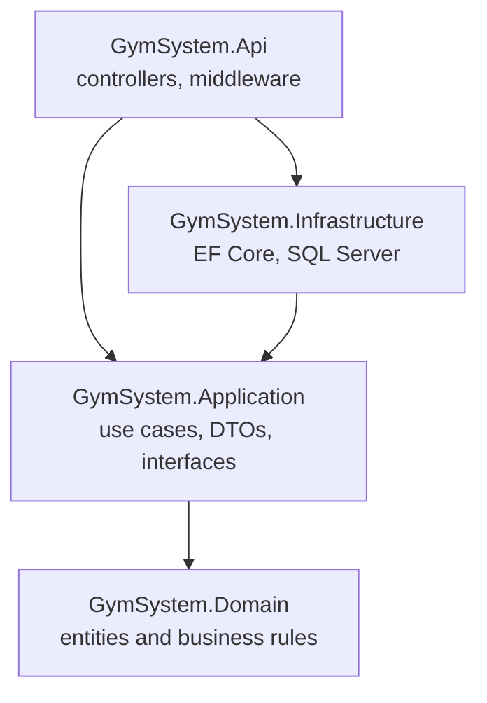

# GymSystem: Multi-Branch Gym Management API

A backend API for gym memberships and class bookings with a waitlist, built with **ASP.NET Core**, **Entity Framework Core** and **SQL Server** using **Clean Architecture**.

The focus of the project is business rules and correctness: a membership state machine, capacity and waitlist handling, and protection against two people booking the last spot at the same time.

<!-- Add a screenshot of the Scalar page at docs/scalar.png, then uncomment the next line -->
<!--  -->

## Features

**Memberships**
- Buy a plan (Monthly, Quarterly or Annual)
- Lifecycle managed as a state machine: `Active`, `Frozen`, `Expired`, `Cancelled`
- A membership can be frozen once, for up to 30 days, and the end date is extended by the days frozen
- Invalid transitions (for example cancelling an already cancelled membership) are rejected by the domain

**Class booking**
- Booking requires an active membership that covers the class date
- A member cannot book the same class twice or two classes that overlap in time
- When a class is full, the member joins a **waitlist**
- Cancelling frees a spot and automatically promotes the first person on the waitlist
- Cancelling less than 2 hours before the class is recorded as a late cancellation

**Timetable**
- List the classes of a branch for a given day, with spots left

**Reliability**
- Optimistic concurrency, so two simultaneous requests cannot both take the last spot
- Request validation with FluentValidation
- One central place that turns errors into consistent JSON responses

## Architecture

The solution follows Clean Architecture. Dependencies point inward, so the business rules never depend on the database or the web framework.



```
GymSystem/
├── GymSystem.Domain/            Entities, enums and business rules (no dependencies)
│   ├── Entities/
│   ├── Enums/
│   └── Exceptions/
├── GymSystem.Application/       Use cases, DTOs, validators and interfaces
│   ├── Abstractions/
│   ├── Bookings/
│   ├── Memberships/
│   ├── Timetable/
│   └── Common/
├── GymSystem.Infrastructure/    EF Core, SQL Server, repositories, dev seeder
│   ├── Persistence/
│   ├── Repositories/
│   ├── Services/
│   └── Migrations/
├── GymSystem.Api/               Controllers, middleware and startup
│   ├── Controllers/
│   └── Middleware/
└── GymSystem.Tests/             Unit tests and a SQL Server integration test
```

## Key design decisions

- **Rules live in the domain.** `Membership` and `ClassSession` expose methods such as `Freeze`, `Book` and `Cancel` and reject invalid operations themselves. Setters are private, so the rules cannot be bypassed.
- **`ClassSession` is the aggregate root for bookings.** Capacity and the waitlist are only correct if bookings are managed in one place.
- **Time is injected.** Domain methods receive `now` and the services use an `IDateTimeProvider`, so time-dependent rules are tested without waiting for the clock.
- **The Application layer owns the interfaces.** Repositories, the unit of work and the clock are declared in Application and implemented in Infrastructure, so the database can be swapped or faked in tests.
- **Optimistic concurrency.** `ClassSession` has a SQL Server `rowversion` column, and every booking or cancellation also updates the class row. If two requests race for the last spot, the second one fails the version check, EF's `DbUpdateConcurrencyException` is translated into an application-level `ConcurrencyException`, and the API returns `409 Conflict`. An integration test against a real SQL Server database proves this behavior.
- **Central error handling.** One middleware maps `DomainException` to 400, `NotFoundException` to 404, `ConcurrencyException` to 409 and anything unexpected to a generic 500 that never leaks internal details.
- **Enums are stored as strings** in the database, so reordering an enum later cannot silently corrupt existing rows.

## API endpoints

| Method | Route | Description |
|---|---|---|
| `GET` | `/api/timetable?branchId={id}&date={yyyy-MM-dd}` | Classes of a branch on a day, with spots left |
| `POST` | `/api/memberships` | Buy a membership (`memberId`, `planId`) |
| `POST` | `/api/memberships/{memberId}/freeze` | Freeze the current membership |
| `POST` | `/api/memberships/{memberId}/unfreeze` | Unfreeze it |
| `POST` | `/api/bookings` | Book a class (`memberId`, `classSessionId`) and get `Booked` or `Waitlisted` |
| `POST` | `/api/bookings/cancel` | Cancel a booking and promote the waitlist |

Error responses use a simple JSON body: `{ "error": "message" }`.

| Status | Meaning |
|---|---|
| 400 | Validation failed or a business rule was broken |
| 404 | The class, plan or membership was not found |
| 409 | Another request changed the class at the same moment, try again |
| 500 | Unexpected error |

## Tech stack

- C# and ASP.NET Core Web API (.NET 10)
- Entity Framework Core with SQL Server (Code First migrations)
- FluentValidation
- xUnit and Moq
- Scalar (interactive API documentation generated from OpenAPI)

## Getting started

**Prerequisites**
- [.NET 10 SDK](https://dotnet.microsoft.com/download)
- SQL Server (Developer edition or LocalDB)
- EF Core tools: `dotnet tool install --global dotnet-ef`

**Run it**

```bash
git clone https://github.com/Othdu/GymSystem.git
cd GymSystem
```

1. Check the connection string in `GymSystem.Api/appsettings.json`:
   ```json
   "DefaultConnection": "Server=localhost;Database=GymSystemDb;Trusted_Connection=True;TrustServerCertificate=True"
   ```
2. Create the database:
   ```bash
   dotnet ef database update --project GymSystem.Infrastructure --startup-project GymSystem.Api
   ```
3. Start the API:
   ```bash
   dotnet run --project GymSystem.Api
   ```
4. Open `https://localhost:<port>/scalar/v1` (the port is in `GymSystem.Api/Properties/launchSettings.json`).

In the Development environment the app seeds sample data on startup: 2 branches, 2 instructors, 3 plans, 4 members and a few classes for tomorrow, including two overlapping classes and one with only 2 spots, so the rules are easy to try.

**Try the main flow**
1. `POST /api/memberships` for members 1, 2 and 3 with `planId` 1
2. `POST /api/bookings` for members 1, 2 and 3 into the 2-spot class: the first two are `Booked`, the third is `Waitlisted`
3. `POST /api/bookings/cancel` as member 1: member 3 is promoted from the waitlist

## Tests

```bash
dotnet test
```

- Unit tests cover the membership state machine, booking and waitlist rules, late cancellation and the booking service (with mocked repositories).
- An integration test runs against a real SQL Server database, which it creates and deletes itself, and proves that two simultaneous bookings for the last spot cannot both succeed. SQL Server must be running to execute it.

## Roadmap

- [x] Domain model and business rules
- [x] Application layer with validation
- [x] EF Core persistence and migrations
- [x] REST API with central error handling
- [x] Unit and integration tests
- [ ] JWT authentication and role-based authorization (the member ID will come from the token instead of the request)
- [ ] Redis caching for the timetable
- [ ] Background job to expire memberships
- [ ] Message queue for waitlist promotion notifications
- [ ] Docker and Docker Compose
- [ ] Deployment to Azure

## Author

**Mohamed Mustafa Saad**, Junior .NET Backend Developer

[GitHub](https://github.com/Othdu) · [LinkedIn](https://linkedin.com/in/mohamed-mustafa811)
