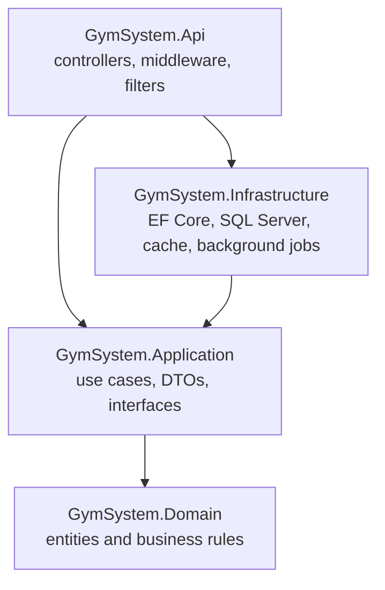

# GymSystem: Multi-Branch Gym Management API

A backend API for gym memberships and class bookings with a waitlist, built with **ASP.NET Core**, **Entity Framework Core** and **SQL Server** using **Clean Architecture**.

The focus of the project is business rules and correctness: a membership state machine, capacity and waitlist handling, protection against two people booking the last spot at the same time, and role-based access for three kinds of users (members, instructors and admins).


<!--  -->

## Features

**Authentication and authorization**
- Hand-built JWT authentication with BCrypt password hashing (no ASP.NET Core Identity, to show how the pieces work)
- Three roles: `Member`, `Instructor` and `Admin`
- A person never chooses their own role: members register through the public endpoint, instructor accounts are created by an admin, and admin accounts come from the seeder
- The member or instructor ID is read from the token, never from the request body, so nobody can act as someone else by changing a number
- Resource-based authorization: an instructor can only manage attendance for **their own** classes (403 otherwise)

**Memberships**
- Buy a plan (Monthly, Quarterly or Annual)
- Lifecycle managed as a state machine: `Active`, `Frozen`, `Expired`, `Cancelled`
- A membership can be frozen once, for up to 30 days, and the end date is extended by the days frozen
- Invalid transitions (for example cancelling an already cancelled membership) are rejected by the domain
- A **nightly background job** expires memberships whose end date has passed

**Class booking**
- Booking requires an active membership that covers the class date
- A member cannot book the same class twice or two classes that overlap in time
- When a class is full, the member joins a **waitlist**
- Cancelling frees a spot and automatically promotes the first person on the waitlist
- Cancelling less than 2 hours before the class is recorded as a late cancellation

**Instructors**
- See their own classes for a day, with the members booked into each
- Mark each booked member as `Attended` or `NoShow` once the class has started

**Admin**
- Create branches, membership plans and classes
- Create instructor accounts (the profile and the login are saved together in one transaction)
- A class cannot start in the past, and an instructor cannot teach two overlapping classes

**Timetable**
- List the classes of a branch for a given day, with spots left
- Served through a cache (see the design decisions below)

**Reliability**
- Optimistic concurrency, so two simultaneous requests cannot both take the last spot
- Request validation with FluentValidation, applied by a global action filter
- One central place that turns errors into consistent JSON responses

## Architecture

The solution follows Clean Architecture. Dependencies point inward, so the business rules never depend on the database or the web framework.



```
GymSystem/
├── GymSystem.Domain/            Entities, enums and business rules (no dependencies)
│   ├── Entities/
│   ├── Enums/
│   └── Exceptions/
├── GymSystem.Application/       Use cases, DTOs, validators and interfaces
│   ├── Abstractions/
│   ├── Admin/
│   ├── Auth/
│   ├── Bookings/
│   ├── Instructors/
│   ├── Memberships/
│   ├── Timetable/
│   └── Common/
├── GymSystem.Infrastructure/    EF Core, SQL Server, repositories, cache, background jobs, dev seeder
│   ├── BackgroundJobs/
│   ├── Persistence/
│   ├── Repositories/
│   ├── Services/
│   └── Migrations/
├── GymSystem.Api/               Controllers, middleware, filters and startup
│   ├── Contracts/
│   ├── Controllers/
│   ├── Extensions/
│   ├── Filters/
│   └── Middleware/
└── GymSystem.Tests/             Unit tests and a SQL Server integration test
```

## Key design decisions

- **Rules live in the domain.** `Membership` and `ClassSession` expose methods such as `Freeze`, `Book`, `Cancel` and `MarkAttendance` and reject invalid operations themselves. Setters are private, so the rules cannot be bypassed.
- **`ClassSession` is the aggregate root for bookings.** Capacity and the waitlist are only correct if bookings are managed in one place.
- **Time is injected.** Domain methods receive `now` and the services use an `IDateTimeProvider`, so time-dependent rules are tested without waiting for the clock.
- **The Application layer owns the interfaces.** Repositories, the unit of work, the clock, the password hasher and the cache are declared in Application and implemented in Infrastructure, so the database or the cache can be swapped or faked in tests.
- **Optimistic concurrency.** `ClassSession` has a SQL Server `rowversion` column, and every booking or cancellation also updates the class row. If two requests race for the last spot, the second one fails the version check, EF's `DbUpdateConcurrencyException` is translated into an application-level `ConcurrencyException`, and the API returns `409 Conflict`. An integration test against a real SQL Server database proves this behavior.
- **Two layers of authorization.** `[Authorize(Roles = "...")]` is the door lock: it answers "are you an instructor?". The question "is this *your* class?" can only be answered after the class is loaded, so the service compares the instructor ID from the token with the class owner and throws a `ForbiddenException`. ASP.NET Core's `IAuthorizationService` with a custom handler is the framework's version of the same idea, and a possible later refactor.
- **Validation in one place.** A global action filter runs the FluentValidation validator for every request body and returns a `400` with the list of problems before the controller code runs. It replaces the `FluentValidation.AspNetCore` helper package, which is no longer maintained and does not work with FluentValidation 12.
- **Central error handling.** One middleware maps `DomainException` to 400, `NotFoundException` to 404, `ForbiddenException` to 403, `ConcurrencyException` to 409 and anything unexpected to a generic 500 that never leaks internal details.
- **The membership expiry job reuses the domain.** A `BackgroundService` wakes up at startup and then every 24 hours. It opens a new DI scope for each run (the worker is a singleton, the `DbContext` is scoped), asks the Application service for active memberships past their end date, and calls `Membership.Expire` on each one, so the "only active memberships can expire" rule stays in one place. A failed run is logged and retried at the next interval instead of stopping the application.
- **Timetable caching (cache-aside).** The timetable is read far more often than it changes. The result for each branch and day is stored in memory behind the `ICacheService` interface and expires after 60 seconds. Because `SpotsLeft` changes on every booking, the entry is **deleted after** a booking, a cancellation or the creation of a class has been saved. Deleting after the save matters: deleting first would let a concurrent request re-cache the old data. The 60 second expiry is a safety net in case an invalidation is ever missed.
- **Enums are stored as strings** in the database, so reordering an enum later cannot silently corrupt existing rows.

## API endpoints

Most endpoints need a bearer token. Log in first and paste the token into Scalar's **Authentication** box.

| Method | Route | Role | Description |
|---|---|---|---|
| `POST` | `/api/auth/register` | public | Create a member account and get a token |
| `POST` | `/api/auth/login` | public | Log in and get a token |
| `GET` | `/api/timetable?branchId={id}&date={yyyy-MM-dd}` | public | Classes of a branch on a day, with spots left |
| `POST` | `/api/memberships` | Member | Buy a membership (`planId`) |
| `POST` | `/api/memberships/freeze` | Member | Freeze the current membership |
| `POST` | `/api/memberships/unfreeze` | Member | Unfreeze it |
| `POST` | `/api/bookings` | Member | Book a class (`classSessionId`) and get `Booked` or `Waitlisted` |
| `POST` | `/api/bookings/cancel` | Member | Cancel a booking and promote the waitlist |
| `GET` | `/api/instructor/classes?date={yyyy-MM-dd}` | Instructor | My classes for a day, with attendees |
| `PUT` | `/api/instructor/classes/{classSessionId}/attendance` | Instructor | Mark a member as `Attended` or `NoShow` (own classes only) |
| `POST` | `/api/admin/branches` | Admin | Create a branch |
| `POST` | `/api/admin/plans` | Admin | Create a membership plan |
| `POST` | `/api/admin/classes` | Admin | Create a class |
| `POST` | `/api/admin/instructors` | Admin | Create an instructor account |

| Status | Meaning |
|---|---|
| 400 | Validation failed (with a list of the problems) or a business rule was broken |
| 401 | Missing, invalid or expired token, or wrong email or password |
| 403 | Valid token, but the wrong role or someone else's resource |
| 404 | The class, plan, branch or membership was not found |
| 409 | Another request changed the class at the same moment, try again |
| 500 | Unexpected error |

## Tech stack

- C# and ASP.NET Core Web API (.NET 10)
- Entity Framework Core with SQL Server (Code First migrations)
- JWT bearer authentication and BCrypt
- FluentValidation
- `BackgroundService` for scheduled work and `IMemoryCache` for caching
- xUnit and Moq
- Scalar (interactive API documentation generated from OpenAPI)

## Getting started

**Prerequisites**
- [.NET 10 SDK](https://dotnet.microsoft.com/download)
- SQL Server (Developer edition or LocalDB)
- EF Core tools: `dotnet tool install --global dotnet-ef`

**Run it**

```bash
git clone https://github.com/Othdu/GymSystem.git
cd GymSystem
```

1. Check the connection string in `GymSystem.Api/appsettings.json`:
   ```json
   "DefaultConnection": "Server=localhost;Database=GymSystemDb;Trusted_Connection=True;TrustServerCertificate=True"
   ```
2. Set the JWT signing key. It is **not** stored in the repository, so keep it in user secrets (use your own long random value, at least 32 characters):
   ```bash
   dotnet user-secrets set "Jwt:Secret" "<your-long-random-secret>" --project GymSystem.Api
   ```
3. Create the database:
   ```bash
   dotnet ef database update --project GymSystem.Infrastructure --startup-project GymSystem.Api
   ```
4. Start the API:
   ```bash
   dotnet run --project GymSystem.Api
   ```
5. Open `https://localhost:<port>/scalar/v1` (the port is in `GymSystem.Api/Properties/launchSettings.json`).

In the Development environment the app seeds sample data on startup: 2 branches, 2 instructors, 3 plans, 4 members and a few classes for tomorrow, including two overlapping classes and one with only 2 spots, so the rules are easy to try. It also creates these **development-only** logins:

| Role | Email | Password |
|---|---|---|
| Admin | `admin@gym.local` | `Admin123!` |
| Instructor (Morning Yoga, Pilates) | `sara@gym.local` | `Instructor123!` |
| Instructor (Spinning, HIIT) | `omar@gym.local` | `Instructor123!` |

Members register through `POST /api/auth/register`.

**Try the main flow**
1. Register two or three members, and for each one `POST /api/memberships` with `planId` 1 (use each member's own token)
2. `POST /api/bookings` for each of them into the 2-spot class: the first two are `Booked`, the third is `Waitlisted`
3. `POST /api/bookings/cancel` as the first member: the third member is promoted from the waitlist

**Try the instructor and admin flows**
1. Log in as `admin@gym.local`, create an instructor with `POST /api/admin/instructors`, then log in as that instructor and call `GET /api/instructor/classes`
2. Log in as `omar@gym.local` and try to mark attendance on one of Sara's classes: you get `403`

## Tests

```bash
dotnet test
```

- Unit tests cover the membership state machine, booking and waitlist rules, late cancellation, attendance marking, the instructor ownership check, the admin services, the membership expiry job logic, timetable caching and cache invalidation, and the auth services (with mocked repositories).
- An integration test runs against a real SQL Server database, which it creates and deletes itself, and proves that two simultaneous bookings for the last spot cannot both succeed. SQL Server must be running to execute it.

## Known limitations

These are deliberate simplifications, and what I would change first in a production version:

- **No refresh tokens.** Access tokens last 60 minutes, then the user logs in again.
- **No invite flow for instructors.** The admin types the initial password. A real system would email a one-time link and force a password change.
- **The cache lives inside one running copy of the API.** With several instances, each would have its own cache. A shared cache such as Redis solves that, and the `ICacheService` interface means only one registration line changes.
- **Two admins creating clashing classes for the same instructor at the exact same moment could both pass the overlap check.** Fully preventing it needs a stricter transaction. The risk is small for an admin panel.
- **The expiry job loads the memberships to expire into memory.** That is fine at this scale. For very large tables it should process in batches.
- **Waitlist promotion happens inside the cancel request.** Moving it to a message queue would make the cancel faster and allow notifications.

## Roadmap

- [x] Domain model and business rules
- [x] Application layer with validation
- [x] EF Core persistence and migrations
- [x] REST API with central error handling
- [x] Unit and integration tests
- [x] JWT authentication, role-based and resource-based authorization
- [x] Instructor attendance and admin management endpoints
- [x] Background job to expire memberships
- [x] Timetable caching with invalidation
- [ ] Redis as the shared cache
- [ ] Message queue for waitlist promotion notifications
- [ ] Docker and Docker Compose
- [ ] Deployment to Azure

## Author

**Mohamed Mustafa Saad**, Junior .NET Backend Developer

[GitHub](https://github.com/Othdu) · [LinkedIn](https://linkedin.com/in/mohamed-mustafa811)